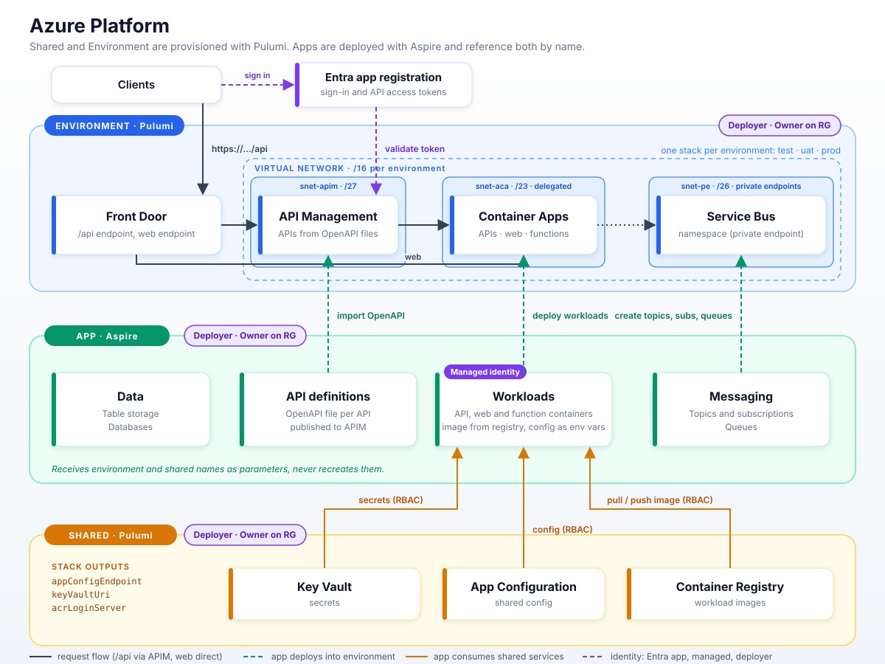

# azure.platform

Infrastructure as code for an Azure platform, split into three areas that are deployed independently:

| Area | Tooling | What it owns | Lifecycle |
|---|---|---|---|
| **Shared** | Pulumi | App Configuration, Key Vault, Container Registry | Once, used by every environment |
| **Environment** | Pulumi | VNet, Service Bus, API Management, Front Door, Container Apps environment, AI Foundry, AI Search, Private DNS zones | One stack per environment (`test`, `uat`, `prod`, ...) |
| **App** | Aspire | Topics and subscriptions, queues, table storage, databases, workloads (APIs, web, functions) | Per app, per environment |



## Principles

- **Layered ownership.** Each layer only creates what it owns. The app layer never creates or modifies shared or environment resources, it receives their names as parameters and looks them up.
- **Pulumi for platform, Aspire for apps.** Shared and environment are long-lived foundations. Apps change often and carry their own infrastructure, so they are described next to the code in an Aspire AppHost.
- **Config in App Configuration, secrets in Key Vault.** Shared config and shared secrets live in the shared layer. App config is injected into the container as environment variables. App secrets are stored in Key Vault and referenced, never put in an environment variable value or source control.

## Repository layout

```
.
├── docs/                 Diagrams and extra documentation
├── common/               Platform.Common: shared names, address plan, DNS zone names
├── shared/               Pulumi project: App Configuration, Key Vault, Container Registry
├── environment/          Pulumi project: VNet, Service Bus, APIM, Front Door, Container Apps
└── app/                  Aspire solution: the Orders sample app (AppHost, web, two APIs, a job), see app/README.md
```

Proposed contents (to confirm as we build):

```
shared/
├── Pulumi.yaml
├── Pulumi.shared.yaml
└── (program)

environment/
├── Pulumi.yaml
├── Pulumi.test.yaml
├── Pulumi.uat.yaml
├── Pulumi.prod.yaml
└── (program)

app/
├── <App>.AppHost/        Aspire AppHost: declares messaging, data, and workload containers
├── <App>.ServiceDefaults/
├── <api-name>/
│   ├── openapi.yaml      Published to APIM
│   └── (service code, Dockerfile)
├── <web-name>/           Web app (code, Dockerfile)
└── <functions-name>/     Functions app (code, Dockerfile)
```

## Pulumi Cloud

One Pulumi project, `platform`, for both Pulumi folders. The stack name says what it is:

| Folder | Stack |
|---|---|
| `shared/` | `shared` |
| `environment/` | `test`, `uat`, `prod` |
| `app/` | `app-test`, `app-uat`, `app-prod` |

Both use the ESC environment `azure/test` for Azure login (OIDC).

## The three areas

### Shared (Pulumi)

Deployed first, once. Everything here is referenced by all environments and apps.

- **App Configuration** for shared, non-secret configuration.
- **Key Vault** for shared secrets.
- **Container Registry** for workload images (APIs, web, functions).

Stack outputs, consumed by the other layers: `appConfigEndpoint`, `keyVaultUri`, `acrLoginServer` (plus resource names and resource group).

### Environment (Pulumi)

One stack per environment, named for the environment (`test`, `uat`, `prod`). Deployed after shared.

- **VNet** with dedicated subnets for APIM and Container Apps, and a subnet for private endpoints (see Network layout).
- **Service Bus** namespace. Apps create their own topics, subscriptions and queues inside it.
- **AI Foundry** resource, one per environment, for model deployments and agents. Reached through a private endpoint.
- **AI Search** service, one per environment. Apps create their own indexes in it. Reached through a private endpoint.
- **API Management** hosting every API. APIs are added by the app layer, not here.
- **Front Door** with a single `api` endpoint that routes to APIM, plus a web endpoint that routes straight to web container apps.
- **Private DNS zones**, one set per environment, linked to that environment's VNet (see Private DNS).
- **Container Apps environment** (ACA) integrated with the VNet. It hosts every workload type: APIs, web apps and functions. Identity granted `AcrPull` on the registry and read access to Key Vault and App Configuration.

Stack inputs: environment name and a reference to the shared stack (via `StackReference` or passed in values).
Stack outputs: `environmentName`, `apimName`, `serviceBusNamespace`, `foundryEndpoint`, `searchEndpoint`, `containerAppsEnvironmentName`, `frontDoorEndpoint`, resource group.

### Network layout

Each environment has its own VNet. APIM and Container Apps each get a dedicated subnet because both require exclusive use of their subnet. Everything else that is PaaS (Service Bus, AI Foundry, AI Search, Key Vault, Container Registry, App Configuration) is reached through private endpoints in a shared endpoint subnet.

| Subnet | Size | Holds | Notes |
|---|---|---|---|
| `snet-apim` | /27 | API Management | Dedicated. Delegation and NSG rules depend on the APIM tier (v2 tiers use VNet integration, Developer/Premium use internal mode). |
| `snet-aca` | /23 | Container Apps environment | Dedicated and delegated to `Microsoft.App/environments`. Sized for growth: replicas consume addresses. A workload-profiles environment can use as small as /27 but /23 leaves headroom. |
| `snet-pe` | /26 | Private endpoints | Service Bus, AI Foundry, AI Search, and the shared Key Vault, Container Registry and App Configuration. Private DNS zones are linked to the VNet. |

Address plan, one /16 per environment so VNets can be peered later without overlap:

| Environment | VNet | `snet-apim` | `snet-pe` | `snet-aca` |
|---|---|---|---|---|
| test | `10.10.0.0/16` | `10.10.0.0/27` | `10.10.0.64/26` | `10.10.2.0/23` |
| uat | `10.20.0.0/16` | `10.20.0.0/27` | `10.20.0.64/26` | `10.20.2.0/23` |
| prod | `10.30.0.0/16` | `10.30.0.0/27` | `10.30.0.64/26` | `10.30.2.0/23` |

The rest of each /16 (`x.x.4.0` upward) is reserved for future subnets.

#### Private DNS

Private DNS zones are **per environment**, created by the environment stack and linked only to that environment's VNet. Private endpoints register their records in the zones automatically through a DNS zone group.

Why per environment: the shared Key Vault, Container Registry and App Configuration are single instances, but each environment creates its own private endpoint to them with its own IP. A single shared zone holds one record per name, so environments would overwrite each other. Per-environment zones let the same name resolve to the local endpoint IP in each VNet, and keep test changes away from prod resolution.

| Zone | Used by |
|---|---|
| `privatelink.vaultcore.azure.net` | Key Vault (shared) |
| `privatelink.azurecr.io` | Container Registry (shared) |
| `privatelink.azconfig.io` | App Configuration (shared) |
| `privatelink.servicebus.windows.net` | Service Bus |
| `privatelink.search.windows.net` | AI Search |
| `privatelink.cognitiveservices.azure.com`, `privatelink.openai.azure.com` | AI Foundry |
| Container Apps environment domain | Only if the environment uses an internal load balancer |

If the platform later grows a hub network with central DNS, firewall or on-premises connectivity, zones would move to the hub. That is out of scope for now.

- **Front Door** is a global service and needs no subnet. It reaches APIM and the Container Apps environment over Private Link (Front Door Premium) or their public endpoints locked to Front Door.
- **Shared services** have no VNet of their own. Each environment creates private endpoints to them in its `snet-pe`, so the shared Pulumi stack only needs to allow private endpoint connections.
- **NSGs** on `snet-apim` and `snet-aca` allow only what each service requires, plus Front Door as the inbound source.

### App (Aspire)

Deployed last, per app and environment. The AppHost takes the environment and shared resource names as **parameters** and treats them as existing resources.

What an app can declare:

- **Messaging:** Service Bus topics, subscriptions and queues (inside the environment namespace).
- **Data:** table storage, databases.
- **Workloads**, each a container app in the environment's ACA:
  - **APIs:** a container per API, with its OpenAPI file, published through APIM.
  - **Web:** web apps, served through Front Door directly (not via APIM).
  - **Functions:** Azure Functions in containers, triggered by Service Bus, timers or HTTP (HTTP functions can be published through APIM like any API).

What the deployment does for each workload:

1. Builds the image and pushes it to the shared Container Registry.
2. Deploys a container app revision into the environment's ACA, pulling the image from the registry.
3. For APIs only, imports the API's `openapi.yaml` into APIM. Web apps get a Front Door route instead.
4. Sets the app's config as environment variables and wires secrets from Key Vault.

## Request path

```
APIs:  Client -> Front Door (api) -> API Management -> Container App -> Service Bus / data
Web:   Client -> Front Door (web) -> Container App
Funcs: Service Bus / timer / HTTP via APIM -> Container App (Functions)
```

Front Door exposes one `api` endpoint for all APIs. APIM routes by API path to the right container app, so adding an API never requires a Front Door change. Web apps are reached through their own Front Door endpoint.

## Identity

| Identity | Used for | Created by |
|---|---|---|
| **Managed identities** | Azure resource permissions. Each workload runs as its own identity and is granted only the roles it needs via RBAC. | App (Aspire), one per workload |
| **Deployer identities** | Create the services and grant access. Each layer is deployed by its own identity with **Owner** on that layer's resource group. Owner (not Contributor) is needed because deployments create role assignments for the workload managed identities. | Created once by hand or bootstrap script |
| **Entra app registration** | User sign-in and API access tokens. APIM validates the token on `/api` calls, and web apps use it for sign-in. | To confirm (see open questions) |

Deployer identities, one per layer, used by CI/CD (federated credentials, no stored secrets):

| Deployer | Tool | Owner on |
|---|---|---|
| Shared | Pulumi | Shared resource group |
| Environment | Pulumi | Environment resource group (one per environment) |
| App | Aspire | App resource group |

The app deployer also needs to create role assignments on resources it does not own, so workload identities can reach the shared Key Vault, Container Registry and App Configuration, and the environment's Service Bus and APIM. Grant it only role-assignment rights there (for example `Role Based Access Control Administrator` with conditions), not Owner.

Typical role assignments for a workload identity:

- `AcrPull` on the shared Container Registry.
- `Key Vault Secrets User` on the shared Key Vault.
- `App Configuration Data Reader` on shared App Configuration.
- `Azure Service Bus Data Sender` / `Receiver` on its own topics and queues.
- `Search Index Data Contributor` / `Reader` on the environment AI Search, for apps that read or write indexes.
- `Azure AI User` (or `Cognitive Services User`) on the environment AI Foundry, for apps that call models.
- Data roles on its own tables or databases.

## Configuration and secrets

| Kind | Stored in | Delivered to the app as |
|---|---|---|
| Shared config | App Configuration (shared) | Read at deploy, set as environment variables |
| App config | App deployment | Environment variables on the container app |
| Shared secrets | Key Vault (shared) | Key Vault reference on the container app |
| App secrets | Key Vault (shared) | Key Vault reference on the container app |

Secrets use managed identity to read Key Vault. No secret values appear in the repo or in environment variable values.

## Deployment order

```
1. shared                 pulumi up (once)
2. environment <env>      pulumi up -s <env>, reads shared outputs
3. app                    aspire deploy, parameters: env name + shared names
```

Teardown is the reverse. Removing an app removes only its topics, queues, data and API definitions.

## Open questions

- **Deployer bootstrap:** who creates the deployer identities and resource groups, and is one app resource group used per app or per environment?
- **App deployer scope:** exact role-assignment rights on the shared and environment resource groups.
- **Entra app ownership:** is the app registration created by the environment (Pulumi), by each app (Aspire), or by hand? One per environment or one per app/API?
- **Entra auth scope:** APIM token validation only, or also sign-in for web apps and functions?
- **Naming convention:** pattern for resource names (for example `{workload}-{env}-{region}`) and whether shared names include the environment.
- **Cross-stack references:** resolved by `common/Platform.Common`. Names and resource ids are derived, not read from stack outputs.
- **Subscriptions:** is shared in one subscription with environments in separate ones, or everything in one?
- **Shared across environments:** a single registry/Key Vault/App Configuration for all environments, or does prod get its own shared instance? Key Vault and App Configuration may want per-environment labels or separate vaults for prod secrets.
- **AI services:** which model deployments live in the environment Foundry versus per app, and the AI Search SKU (it drives replica and partition cost per environment).
- **Network assumptions:** confirm the address ranges, APIM tier (decides its subnet size and delegation), and whether Front Door Premium with Private Link is used.
- **Web routing:** web endpoint hostname per app, or path-based routing on one web endpoint.
- **Functions exposure:** Service Bus and timer triggers only, or also HTTP through APIM.
- **Aspire to APIM:** use an Aspire publisher/Bicep step or a small post-deploy step to import OpenAPI into APIM.
- **CI/CD:** GitHub Actions workflows per folder, with path filters.

## Roadmap

1. Scaffold the three folders and CI per folder.
2. Shared Pulumi project.
3. Environment Pulumi project, deploy `test`.
4. Sample app in Aspire (done: `app/`, publishes; to do: deploy, APIM import, Front Door web route).
5. Add `uat` and `prod`, then lock down networking.
